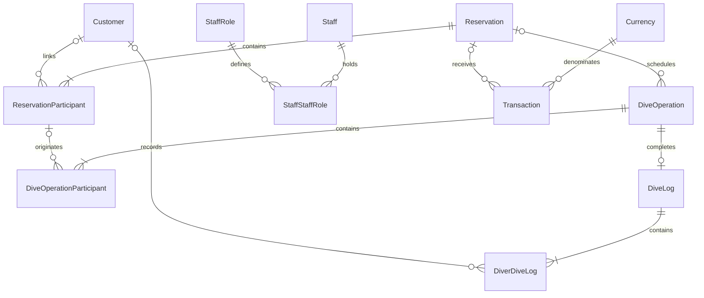

# Architecture and data rules

## Boundaries

One `net10.0-windows` WPF project contains:

- `Models`: normalized entities, enums and field validation attributes.
- `Data`: EF context, migrations, required configuration, optional catalog defaults and isolated sample data.
- `Services`: focused application operations and queries. Customer, activity, dive-site, staff, boat, equipment, currency and transaction-category services own typed EF queries and catalog rules. `MasterDataService` routes existing lookup/editor/sample callers to those services. Internal `CatalogPersistence` helpers share scalar tracking and deactivation, without abstracting EF queries or exposing operational aggregates.
- `ViewModels`: presentation state, `ObservableCollection` lists, field metadata, filters and commands. ViewModels do not access DbContext or SQLite.
- `Views`: each PHASE 2 module has a named WPF View and typed ViewModel, composed from reusable lists/editors. Dashboard, schedule, date-input feedback and presentation-only column generation remain separate.
- `Commands`, `Helpers`, `Converters`, `Resources`: MVVM plumbing, local paths, presentation metadata and the shared visual system.
- `Diagnostics`: an opt-in acceptance harness using the same production DI registration, services, WPF resources, migrations and on-disk SQLite provider.

`AppServices.AddDiveHub` is the composition root. `IDbContextFactory<DiveCenterDbContext>` creates short-lived contexts. Aggregate saves use explicit transactions. The desktop mutex prevents simultaneous application instances for the same database; no static global DbContext exists.

`AppPaths` owns the normalized workspace, database path and SQLite connection string. Startup and the design-time EF factory share that configuration. Folder/file conflicts, write access and read-only database attributes are validated before startup queries. Development sample mode and verification require separate workspaces; normal startup seeds only configuration catalogs.

## Relational workflow



The database enforces unique reservation numbers and one shared log per operation. A linked customer appears at most once in one shared log; temporary visitors may remain unlinked. All foreign keys use `Restrict`, including historical master references. Child changes are explicit aggregate operations, never cascading historical deletes.

Reservation numbers are allocated through a yearly sequence inside the reservation transaction. Activity dates are date-only values; times are local time-of-day values. `CreatedAt`/`UpdatedAt` timestamps use UTC.

The application tracks imported dive history separately from locally recorded logs. `TotalLoggedDives` combines the prior count with current personal logs. Correcting a log refreshes the count and most recent date without destroying imported history.

## Operational rules

- Optional certification supports try dives. Existing-customer selection copies a participant snapshot; temporary participants remain separate from customer profiles.
- New assignments require active master records. An unchanged historical reference may remain inactive during corrections.
- Instructor assignment requires the active Instructor staff role. The role's reserved name cannot be renamed; other roles are editable.
- Participant count is derived from reservation participants. Boat capacity and duplicate customer assignments are checked before saving.
- Pending/confirmed diving or training bookings may generate editable operation drafts. Cancelled, no-show, rental and other non-diving bookings are excluded.
- Operation transitions are Planned → InProgress → Completed, with cancellation allowed before completion. Closed operations are read-only; log measurements remain editable.
- A completed operation creates or reopens its single shared dive log. Personal depth/time values override shared values only for that diver. Aggregate saves preserve personal row IDs; individual edits update only that diver. Customer totals and last-dive dates are recalculated in the same transaction, preserving prior history.
- Nitrox requires oxygen in the inclusive range 21–100. Air/Other require the Nitrox oxygen field to be clear. Depth, bottom time and pressure are nonnegative. Exit time must be on or after entry on the dive date; bottom time cannot exceed that duration. New drafts leave actual duration at zero until entered.

## Cash rules

`Transaction.Amount` is a positive `decimal`; transaction type determines its sign in a balance. SQLite's TEXT decimal representation avoids binary floating-point storage. Date/type/currency/category/activity/reservation constraints run in SQLite. Text search matches description/category/activity after materialization using .NET Unicode-aware comparisons. The screen rows and independent currency balances are built from the same read transaction; all money aggregation uses `decimal`.

Each balance/report group includes a currency code. There is no combined balance, exchange-rate lookup, accounting ledger, invoice or conversion. A currency code with existing transactions cannot be renamed. Category compatibility is checked on each transaction save and the editor restricts category choices to the selected type. CreatedAt is preserved on edit; UpdatedAt is set automatically. Reservation details list their cash records and totals by currency. No outstanding amount is inferred from mutable catalog default prices. Deletion requires an explicit confirmation flag after the desktop confirmation dialog.

## Dashboard and reports

`DashboardService` and `ReportService` query the context factory directly. They project display rows or SQL aggregates, without loading full transaction, reservation, operation or log graphs. Each result is read in a single database transaction. ViewModels receive records, never a DbContext.

Date filters use inclusive calendar days as `column >= start` and `column < next day`, preserving index-friendly predicates and accepting timestamps on the final day. The maximum date is handled without overflowing. SQLite cannot order EF TimeSpan values natively, so only filtered scalar reservation/operation rows are ordered by time in memory; other grouping, counts, ordering and recent-row limits run in SQL.

Dashboard headcount unions customer IDs and temporary participant identities from active/completed reservations and non-cancelled operations. Copied reservation participants and repeat customers count once; operation staff roles are excluded. Upcoming bookings cover today through six days later, with pending/confirmed status. Recent dives are the last six completed operations by log/operation date and operation ID, with shared log measurements when available. Today's income/expense and all-time balances have separate fields for every currency.

All sixteen reports use SQL date/context filters and scalar projections. Group keys include entity IDs so identical display names cannot merge different activities, sites, instructors or categories. Shared-dive reports use the operation's lead instructor; personal history uses the instructor on the diver's log. Logged customer totals combine prior history and actual local logs; period counts remain filtered. Monthly summaries query the whole selected year and fill twelve months for each active or historically used currency. Activity summaries add only integer transaction/person/dive counts across currency rows; income always retains its currency.

Money `Sum(decimal)` translates to the SQLite provider's decimal `ef_sum` function, preserving decimal precision without converting values to REAL/double. This is supported by the pinned EF Core 10 provider and verified against on-disk SQLite commands in the acceptance harness. See the [official SQLite function mapping](https://learn.microsoft.com/en-us/ef/core/providers/sqlite/functions#aggregate-functions).

## Migrations and backup

`DatabaseInitializer` applies checked-in Code First migrations, enables WAL and installs only currencies, cash categories and staff roles. Before upgrading an existing file, it requests a verified online backup. Reference activity/site names are a separate user action. Development business data runs only when explicitly requested and selects a separate sample directory by default.

`BackupService` uses `SqliteConnection.BackupDatabase` on a worker thread, finalizes the copy with journal mode DELETE, checks the snapshot, and replaces the chosen destination only after verification. It refuses the live database and its journal paths, resolves existing junction/link path segments, and holds a Windows file handle that prevents replacement of the live source through an alternative path. Destinations with journal sidecars are rejected. Preference-file and cleanup errors are logged without masking the actual backup result. `Open Backup Folder` remembers the last successful folder and falls back to the default if it is unavailable.

To add a migration:

```powershell
dotnet tool restore --configfile NuGet.Config
dotnet ef migrations add DescriptiveName --project DiveCenterManager --output-dir Data/Migrations -- --data-dir "C:\DiveHubDevelopment"
dotnet build DiveCenterManager.sln
```

The checked-in migration snapshot is validated by the acceptance harness. Do not replace migrations with `EnsureCreated`.

## UI and recovery

Colors, typography, controls, status colors and sidebar styles are shared ResourceDictionaries. Editors show property validation alongside fields and aggregate validation in a scrollable form banner. Save commands prevent duplicate submission, field edits and window closing while persistence is pending. Dialog close subscriptions are removed when a dialog closes. Reports use the same safe clear-filter command contract as other screens while preserving the selected report type.

`ErrorMessages` translates database/file failures to actionable text and routes technical details to `AppPaths.Log`. Expected domain failures use ValidationException and remain readable without being logged as crashes. Handled save/query errors stay on the relevant form or screen; application-level errors and backup feedback use a dismissible shell banner. Dispatcher errors are logged and surfaced, unobserved task failures are observed/logged, and fatal process errors are logged where possible. This cannot recover a damaged database, an out-of-memory process or an operating-system failure.
